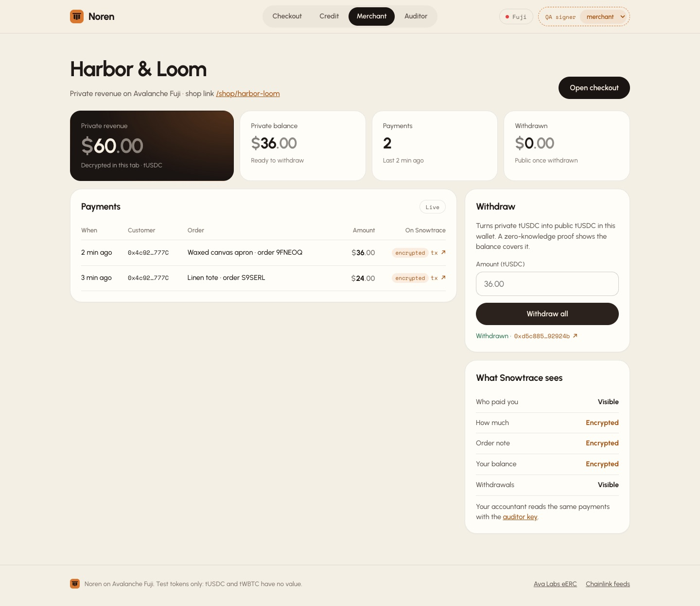
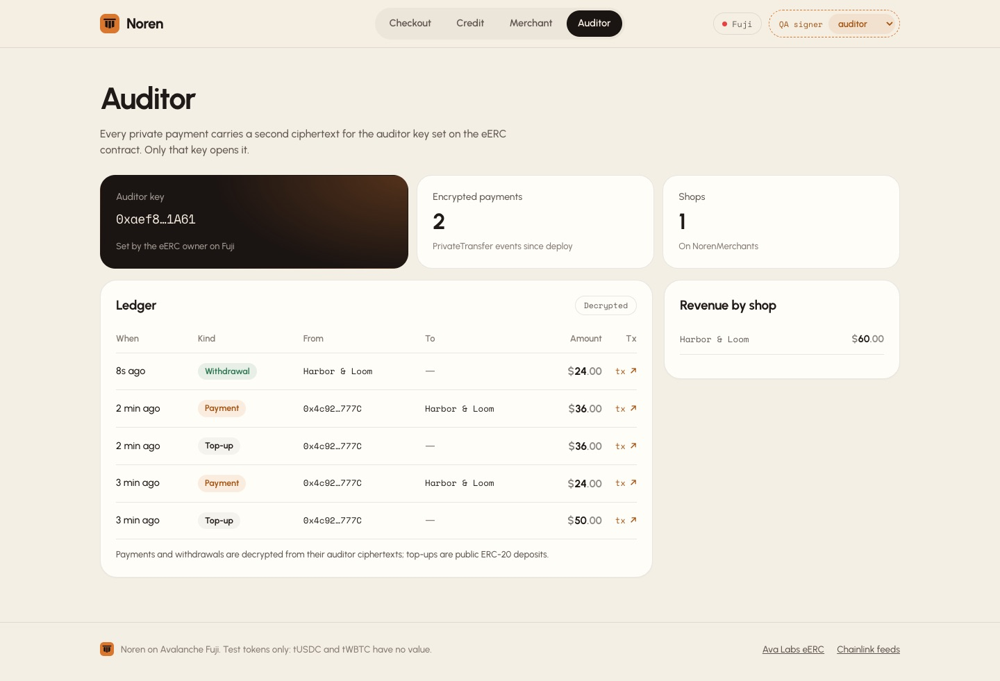
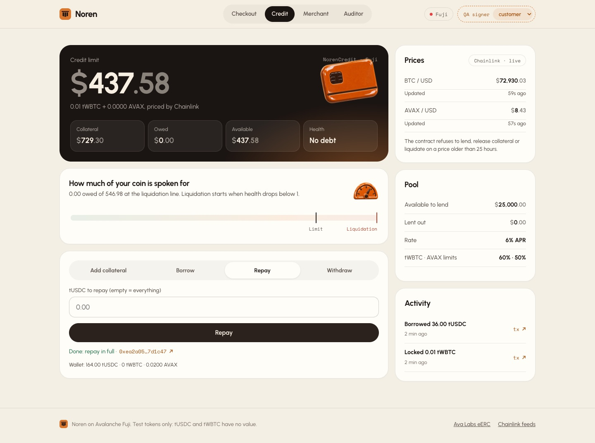

# Noren on Avalanche

**Stablecoins, stocks or credit — privately.** Noren lets merchants accept stablecoins, stocks or credit, and the shop
never learns who paid. Customers **pay with their stocks** (sold at checkout at a signed market price) or **get credit
against their stocks** without selling them (pay in 3, pay later), and the shop is paid in tUSDC through Ava Labs'
EncryptedERC (eERC) on Avalanche: amounts are ciphertexts and payments reach the shop from Noren's settlement hub, in
batches, never from the customer's wallet.

**Why Avalanche.** The NYSE plans to settle tokenized stocks on Avalanche, for its planned 24/7 tokenized securities
venue (announced Nov 9 2026, subject to regulatory approval:
[The Block](https://www.theblock.co/news/business/2026-11-09-nyse-settle-tokenized-stocks-avalanche-planned-24-7-market-436208),
[CoinDesk](https://www.coindesk.com/business/2026/11/09/nyse-picks-avalanche-to-settle-tokenized-stocks-amid-wall-street-s-blockchain-race)).
Noren is where those shares meet a checkout. This build runs on Avalanche Fuji with five test stocks.

This is the **Avalanche edition of the Noren submitted at ETHGlobal** ([showcase](https://ethglobal.com/showcase/noren-bh8wb)):
the same product and the same UI, rebuilt on one chain. See [Prior work](#prior-work-disclosure).

| Surface | Hosted (Fuji, test tokens only) |
|---|---|
| Landing + Noren app (Home · Pay · Earn · Credit · Borrow · Swap) | https://noren-avax.vercel.app · app at `#/app` |
| Noren Merchant + hosted checkout | https://noren-avax-merchant.vercel.app · checkout at `#/pay/<invoice>` |
| Aubelle, a demo shop that takes Noren | https://noren-avax-shop.vercel.app (code in `shop/`) |
| Noren API (hub, gas relay, merchant API, price relayer, assistant) | https://noren-avax-api.201-18-198-162.sslip.io/api/health |

- **Noren Merchant**: sign in with your wallet (SIWE), open your store on Avalanche (`NorenMerchants`, an eERC key
  registered in the browser), payment links, API keys, events, private payouts and itemised statements decrypted in
  your browser and checked against `NorenSettlement`, an accountant, and an assistant (Claude) over your decrypted books.
- **Hosted checkout, four ways to pay, stocks first**: pay with stocks · pay in 3 / pay later against your stocks ·
  pay privately · pay with tUSDC. The first three end in an eERC payment to Noren's hub; only the last is public.
- **Noren app**: Home (balance, paste a link, activity), Pay, Earn (lock stock for credit; fund the credit pool),
  Credit (limit, plans, repay, the limit rising with on-time repayments), Borrow (tWBTC / AVAX at Chainlink prices),
  Swap (stocks ⇄ tUSDC at the desk).

## Try it in a minute, with no wallet and no AVAX

1. Open https://noren-avax-shop.vercel.app, pick a dress, **Checkout with Noren**.
2. On the hosted checkout press **Use a test wallet** (a fresh Fuji key kept in your browser), then **Pay with tNVDA**.
   The steps run on Fuji: NorenGasStation's starter pack (gas, 100 tUSDC, 0.01 tWBTC), your eERC key (a Groth16 proof
   made in the browser), the stock starter pack (2 tNVDA, 1 tTSLA, 2 tAAPL, 1 tMSFT, 1 tSPY), a fresh signed price if
   the on-chain one is over an hour old, the sale at `NorenStockDesk` (a round lot of 50), the top-up into eERC, and the
   eERC payment to the hub. About 35 seconds; Aubelle's order page turns paid once the hub reads it.
3. Open https://noren-avax.vercel.app/#/app, **Use a test wallet**, paste a payment link (make one in Noren Merchant,
   or check out at Aubelle again) and choose **Pay in 3 / Pay later**: your stock is locked, a plan opens, the shop is
   paid privately. In **Credit**, repay an installment: your LTV goes from 60% to 65%.
4. Open https://noren-avax-merchant.vercel.app, **Use a test wallet**, open a store, make a link, pay it from the app,
   and read the payment in **Payments** ("Customer: Private", method Stocks / Pay in 3) and **Balances** after the
   next batch (every 3 minutes).

### Stocks on Fuji

Chainlink has no equity feeds on Fuji (checked against Chainlink's Fuji feed list on Nov 13), so Noren signs real
quotes itself: the relayer on the VPS reads Yahoo Finance's public chart API every 10 minutes, signs a report with its
own key (`NOREN_PRICER_KEY`, holds no AVAX) and submits it. `NorenStockOracle` accepts a report only with that signature,
for this chain and this contract, newer than the last report and not from the future, and every read refuses a report
older than one hour. The quote's own time (`marketTime`, e.g. Thursday's close) is shown in the app. Anyone can submit
the latest signed report (the checkout does, if the on-chain price went stale). The stocks are **test tokens**
(tNVDA, tTSLA, tAAPL, tMSFT, tSPY), not tokenized shares.

| Stock contract | Address | What it does |
|---|---|---|
| NorenStockOracle | [`0x1f2555…4ECA0A`](https://testnet.snowtrace.io/address/0x1f2555025A94D8C8B3cB4238a205611C2d4ECA0A#code) | Signed prices (8 decimals), signature/chain/order/age checks |
| NorenStockDesk | [`0x5D606E…De838`](https://testnet.snowtrace.io/address/0x5D606E92e8909Bfda857A8F850716644ac2De838#code) | Pay with stocks and Swap: buys at the price −0.5%, sells at +0.5% |
| NorenStockCredit | [`0xEf236B…F2417`](https://testnet.snowtrace.io/address/0xEf236B4Dfebf07a163EdbE0Faf60FFb2806F2417#code) | Credit against stocks: lock, limit = value × LTV (60% +5 per on-time installment, max 75%), pay in 3 / pay later plans (1% fee, no interest), liquidation at 85% (5% bonus), Earn pool |
| NorenStockStarter | [`0x4C4ED5…E1dBBe`](https://testnet.snowtrace.io/address/0x4C4ED5C6F3374317EEe4170d3d1111776e2f816a#code) | One test stock pack per wallet |
| tNVDA · tTSLA · tAAPL · tMSFT · tSPY | [`0x280E22…916B`](https://testnet.snowtrace.io/address/0x280E22513Ac8a4a214fCa3593080501AD455916B#code) · [`0xF255d8…A016`](https://testnet.snowtrace.io/address/0xF255d832b186cEE8632aFe1cEA25b7B2f70FA016#code) · [`0x9883d0…5ECf`](https://testnet.snowtrace.io/address/0x9883d0a801a281769Bca3E3D89A3bE941E005ECf#code) · [`0x773f0d…5628`](https://testnet.snowtrace.io/address/0x773f0d46CB1e3361CBEeB256ACa3cf7DFA585628#code) · [`0x695254…1dBBe`](https://testnet.snowtrace.io/address/0x6952540325545650D36e7aa83FEBda5F54E1dBBe#code) | Test stock tokens (18 decimals) |

Live runs through the hosted UI on Nov 13 (each an eERC payment to the hub; amounts encrypted on Snowtrace):

| What | Transaction |
|---|---|
| Aubelle order paid with stocks, privately (158.00 tUSDC) | [`0x530eea90…`](https://testnet.snowtrace.io/tx/0x530eea90b2acc742f2c79a057d495e0922699ed4940474a46b01180a91d2dbee) |
| Aubelle order paid in 3 against stocks (36.00 tUSDC) | [`0x51969346…`](https://testnet.snowtrace.io/tx/0x519693466436a67bfcc723d658cf1d80939ea3c55134e16abb4242394a46bf33) |
| The hub settles batch #15 (three shops paid, two of them zero covers) | [`0x213aa76b…`](https://testnet.snowtrace.io/tx/0x213aa76b55093455537d4814afe56063b5ec89cc55a7d375a7b5e405bd8d6eb0) |
| A signed stock price report submitted by the relayer | [`0x69236726…`](https://testnet.snowtrace.io/tx/0x69236726b97a6f214059c6026182ff394eccd0f2a9c56a2de2cf3525db0259de) |

### The demo film's run (Avalanche Fuji, Nov 13 2026: transactions 09:11–09:18 UTC; the explorer and café-view shots re-filmed read-only at 09:34–09:36 UTC, the café view again at 09:51)

Wallets: Riya `0xf0a643de127c5d8e54d674877b48959d16271ec1` (browser test wallet), Juhu Chai House shop #12 on NorenMerchants (payout wallet `0x036Ec409bB38a14B079F68fE27cd5BF12e871D52`, store opened in `0xf9b642…09d9`), Noren's hub `0x58e374A4c704f1806BAbD04726FB60e86e76A6A7`. Café link `indlflm7bq2a`, Aubelle invoice `inytes4l6ui8` (order AUB-718B5B). Both settled in batch #26.
Since API d472720 the shops never receive the customer's payment transaction: Aubelle's order page and the café's payment page show the method, the batch and the payout only.

| What | Transaction |
|---|---|
| The public stock sale: 0.302372 tNVDA → 50.00 tUSDC at NorenStockDesk (round lot) | [`0x39b9d8bd…2504`](https://testnet.snowtrace.io/tx/0x39b9d8bdf479b0df8311d22eed9c70a94f61316af5005935a37b414ea7a22504) |
| The public top-up: 50.00 tUSDC into Riya's eERC balance | [`0x56519aff…5ba8`](https://testnet.snowtrace.io/tx/0x56519aff04786ecb460732f4cce69efaa909ee7e30eb38053d31cbc7524a5ba8) |
| Riya pays Juhu Chai House 24.00 with stocks: eERC transfer to Noren's hub (amount encrypted, 0 token transfers) | [`0x682d45c0…9f6c`](https://testnet.snowtrace.io/tx/0x682d45c08c1855999b6a5090652709cfd5c228c7c81f37b0e67a20dc32a49f6c) |
| Riya locks 1 tTSLA (limit $238.47 at 60%) | [`0x62fb75ea…a54c`](https://testnet.snowtrace.io/tx/0x62fb75ea67b40a502b376f846d6a73dc22d5d63ac1114524ffa2a0e8d8d0a54c) |
| Pay in 3: the plan draws a round lot of 150.00 tUSDC (3 × 50.50, plan #5) | [`0x1530b27c…ab95`](https://testnet.snowtrace.io/tx/0x1530b27c43ac21d7eaca3fc9b4c32a66e6e1f3cc75c2ae55fa80363210ddab95) |
| Pay in 3: the public top-up of the round lot, 150.00 tUSDC, into her eERC balance | [`0xcc604088…1864`](https://testnet.snowtrace.io/tx/0xcc604088e0d20d75a3a844538b9600c352af7904e5f62a81febdf8fe57201864) |
| Pay in 3: the private payment of 148.00 to Aubelle via the hub (0 token transfers) | [`0xcec68b62…6156`](https://testnet.snowtrace.io/tx/0xcec68b62ecc175cc2240420dca7d4273f10de119e3e37d1c55dea5eb0d426156) |
| Riya repays the first installment, 50.50 tUSDC, on time (LTV 60% → 65%) | [`0xddf4074e…fb5b`](https://testnet.snowtrace.io/tx/0xddf4074e68d58621a29019c8b178bf44f1d6724225121e5489731abcc0f2fb5b) |
| Noren's hub pays Juhu Chai House in batch #26 (eERC PrivateTransfer to `0x036E…1D52`, amount encrypted) | [`0x9ea70736…fd7e`](https://testnet.snowtrace.io/tx/0x9ea707364aed26308a7c8a6eaeb0fc34d2f38e1778bde39cb88b55337331fd7e) |
| Noren's hub pays Aubelle in batch #26 (eERC, amount encrypted) | [`0x689c418a…291e`](https://testnet.snowtrace.io/tx/0x689c418af84fed1bdacc36c21bbb55adc8992d7082021670a888388b3092291e) |

On the explorer the eERC event reads `PrivateTransfer(sender, <receiver>, (ciphertext…), <auditor>)`: in the payment the receiver is the hub `0x58e3…a6a7`, in the payout it is the café `0x036E…1D52`. The film's captions quote that literally.
(Earlier runs: v17 used 08:41–08:53 UTC, Riya `0x04a0…ad7d`, shop #11, batches #24/#25; v12–v16 used 07:22–07:28 UTC, Riya `0x79c1…17ed`, shop #10, batches #22/#23.)

### v17–v18 wording checks
| Line | Proof |
|---|---|
| "Selling the stock and the top-up are public, in round lots of fifty; the amount, and which shop it paid, are not." | v18: sale 0x39b9d8bd… (50.00 tUSDC out), eERC deposits 0x56519aff… (50,000,000 = 50.00 tUSDC) and 0xcc604088… (150,000,000 = 150.00); the payment 0x682d45c0… shows 0 transfers and goes to Noren's hub, the shop is not on chain |
| "Aubelle never learns who paid" / caption "no customer named" | API d472720: invoices and events no longer carry paymentTx for private methods; Aubelle's order page (take 09:15 UTC) shows method, Noren payment id, batch #26 only, no customer field |
| "Her plan: 150.00 tUSDC, a round lot · 3 × 50.50 · 1% fee" | Credit tab plan #5 on screen (v18): "Pay in 3 · 150.00 tUSDC · 151.50 left · 50.50 ×3" |
| "Then the books decrypt in the browser, and the payout is checked against the chain." (v18) | Played only from the frame where Balances shows 24.00 tUSDC, the batch #26 payout row `0x9ea7…fd7e` and its "Checked ✓" badge (merchview take 09:17 UTC; decryption about 1.5 s in real time since product 9f9a47e) |
| "Her pay-in-three payment is the same private call" (v18) | 0xcec68b62… from Riya: `transfer` on eERC `0x35f9…7153`, 0 transfers, 2 events |

## Live on Avalanche Fuji

All contracts are verified on Snowtrace (Routescan). Addresses: [`deployments/fuji.json`](deployments/fuji.json).

| Contract | Address | What it does |
|---|---|---|
| EncryptedERC (Ava Labs, converter mode, 2 decimals) | [`0x35f9E1A8…867153`](https://testnet.snowtrace.io/address/0x35f9E1A8f9e570b5C1f12bdE4202683878867153#code) | Encrypted balances and private transfers over tUSDC |
| Registrar (Ava Labs) | [`0xf3876666…f1bDc4`](https://testnet.snowtrace.io/address/0xf3876666123fC4A15b4503b17Dc8188481f1bDc4#code) | eERC public keys, registered with a Groth16 proof |
| NorenCredit | [`0x8E11c777…Ef0713`](https://testnet.snowtrace.io/address/0x8E11c777f31368c3630992Cd918D42a44EEf0713#code) | Credit line against tWBTC / AVAX at Chainlink prices |
| NorenMerchants | [`0xE1515901…ddB039`](https://testnet.snowtrace.io/address/0xE151590170cc22b8e34c93ABD43f9BAD26ddB039#code) | Shops and catalogues; a shop opens only for a registered eERC key |
| NorenSettlement | [`0x096Bb172…4C6558`](https://testnet.snowtrace.io/address/0x096Bb172202953FF4D5f4d570CEFD815bc4C6558#code) | The hub's batch record: payments settled once, per-shop payouts with statement digests, accountant and auditor copies |
| NorenGasStation | [`0x5e8A4712…887513`](https://testnet.snowtrace.io/address/0x5e8A47127F06b6ec93f2b49FB79768D561887513#code) | One relayed tx gives a new wallet 0.0002 AVAX, 100 tUSDC and 0.01 tWBTC; limits on chain |
| Noren hub (eERC account) | [`0x58e374A4…76A6A7`](https://testnet.snowtrace.io/address/0x58e374A4c704f1806BAbD04726FB60e86e76A6A7) | Receives customer payments, pays shops in batches; key only on the API server |
| Noren gas relayer | [`0x3452fE8B…1e19A9`](https://testnet.snowtrace.io/address/0x3452fE8B3999761d6E889cbc130571A5951e19A9) | The only caller of `drip`; key only on the API server |
| tUSDC (test, 6 decimals) | [`0x788a627c…6303A1`](https://testnet.snowtrace.io/address/0x788a627ceD9B795517A9c481A4377Ea0E26303A1#code) | Faucet: 250 per address per day |
| tWBTC (test, 8 decimals) | [`0x04e7f9a2…A6e754`](https://testnet.snowtrace.io/address/0x04e7f9a2b3c793884Fb9a5C5F424a4739AA6e754#code) | Faucet: 0.01 per address per day |
| Chainlink BTC / USD (Fuji) | [`0x31CF013A…19c602a`](https://testnet.snowtrace.io/address/0x31CF013A08c6Ac228C94551d535d5BAfE19c602a) | Price for tWBTC collateral |
| Chainlink AVAX / USD (Fuji) | [`0x5498BB86…0D06aD`](https://testnet.snowtrace.io/address/0x5498BB86BC934c8D34FDA08E81D444153d0D06aD) | Price for AVAX collateral |

The eERC verifiers (registration, transfer, withdraw, mint, burn) are Ava Labs' production verifiers; their addresses
are in the deploy transactions recorded in `deployments/fuji.json` (`deployTxs`).

### Judge path on the hosted site (zero setup)

<!-- judge -->
Run 2026-11-12 15:24 UTC on https://noren-avax.vercel.app by `scripts/qa/judge.mjs` (a fresh browser, Test wallet 9E69, no keys from this machine):

| Step | Transaction (Snowtrace) |
|---|---|
| starter pack: gas, 100 tUSDC, 0.01 tWBTC | [`0x040fbc9d…`](https://testnet.snowtrace.io/tx/0x040fbc9d17189af243550b582bba9d22568d89b62be82fe1668d6c97db70138b) |
| register eERC key | [`0x554dffa9…`](https://testnet.snowtrace.io/tx/0x554dffa94276b2cd96098574ee04cc418eea5077a0b1fe70dd3497ada0f5dde1) |
| approve tUSDC for eERC | [`0xc293f126…`](https://testnet.snowtrace.io/tx/0xc293f126d965eeaf1c8b8d1485dfedf4857aecb295227b1d37dea5371153f084) |
| top up private balance | [`0x8ad54f8a…`](https://testnet.snowtrace.io/tx/0x8ad54f8a716de8db5cd3466ba4d556b9bd3143347c01ea373eeca5882d0d582f) |
| private payment via Noren for Harbor & Loom | [`0x2656c639…`](https://testnet.snowtrace.io/tx/0x2656c639f00d91648fd06e0859d81c1590b1156f2e975c620465f4a0be2265e0) |
| open shop | [`0x394ea662…`](https://testnet.snowtrace.io/tx/0x394ea6622c522217d60d6856d0bc609e0f1b547e7f57159facc97cb0f51d96ca) |
| list item | [`0xbd3f0f78…`](https://testnet.snowtrace.io/tx/0xbd3f0f781eef92a3933c6814ae3bc776c43b0bd01cbd0035be5537525e8c3d8c) |
| name the shop accountant | [`0xbba7208d…`](https://testnet.snowtrace.io/tx/0xbba7208d4f1223e614bf74433dfe057133a73d534e4aef6e9c254f8555705232) |
| private payment via Noren for Test shop 9e69 | [`0x1c1ac680…`](https://testnet.snowtrace.io/tx/0x1c1ac68094d975bb3a5ac381c81d31ec3a94d6222ecb46525e277002265888eb) |
| hub payout to the test shop (batch) | [`0x05fe1765…`](https://testnet.snowtrace.io/tx/0x05fe1765c4e35f041dc2df516b5776ddea98b9b1817faa72811e6c9ba1731e0d) |

Assistant's answer to "How much did I make this week?": "You made $12.00 this week, from 1 order (average $12.00)."
<!-- /judge -->

### Hub batches on Fuji

Every batch the hub has settled, read back from `NorenSettlement` (`scripts/fuji/record-batches.ts`). Shop ids: 0
Harbor & Loom, 1 Kiln Row, 2 Paper Lantern, 3 and up are shops opened by test wallets. Open any payout on Snowtrace:
it is a hub-to-shop eERC transfer whose amount is ciphertext, and zero-value cover payouts look the same.

<!-- batches -->
| Batch | When (UTC) | Customer payments in | Shop payouts (real or cover; amounts encrypted) | Record |
|---|---|---|---|---|
| #0 | 2026-11-12 15:06 | [`0x2ada496d…`](https://testnet.snowtrace.io/tx/0x2ada496debc2b18479f218049a6b079f476161c13a409a4ceee9344aca81258c) | shop 1: [`0x4b428257…`](https://testnet.snowtrace.io/tx/0x4b42825740c8de2238f7dc042e5af579c096e6d7cca8852a6616141131655335)<br>shop 2: [`0xc1af61ec…`](https://testnet.snowtrace.io/tx/0xc1af61ec1f696fa809eb127437b157edef05cb0e8e1b40231bb1215fca7278b3)<br>shop 0: [`0x3525cb4e…`](https://testnet.snowtrace.io/tx/0x3525cb4ecbaf145f0c24172af4aa7f3863448f07a413dd097398cdba8cece3c3) | [`0xe5eb1160…`](https://testnet.snowtrace.io/tx/0xe5eb116085e345c99d68f7f3025a84b7d76791a68e44a98b86af542de7bbb9b5) |
| #1 | 2026-11-12 15:09 | [`0xa240b516…`](https://testnet.snowtrace.io/tx/0xa240b516033d2e5edc39bc0558be2fe9e5f2c7eed20eebf117a082be0bfe3408) | shop 0: [`0x97b48704…`](https://testnet.snowtrace.io/tx/0x97b48704f53d6cad4f28e8f03711a47b62a3b112a2ed6502ec60bf5b9d5f6765)<br>shop 3: [`0x3fef6efa…`](https://testnet.snowtrace.io/tx/0x3fef6efa26f2bdf813a09f273bbef9ccf4ca17ed756ef849b7ed86f4b917ca2d)<br>shop 2: [`0xfbb804b2…`](https://testnet.snowtrace.io/tx/0xfbb804b2268df6043892c28a1b101c3590e7fdced0bf8eaf3cc538a0d84fd937) | [`0x462471ac…`](https://testnet.snowtrace.io/tx/0x462471ac6fde26fd8d6df49b83254e1ccd26683ff1eceefba30bf211810c8275) |
| #2 | 2026-11-12 15:21 | [`0xc4078550…`](https://testnet.snowtrace.io/tx/0xc4078550ebf229fc7279af2c2e33799df165675f1716ba1805ae2a9171c69e84) | shop 1: [`0x75dbc65a…`](https://testnet.snowtrace.io/tx/0x75dbc65aec6d24193bb79f2ba836fdbf94ac37706e8cb1c1aa60bdf6232e3257)<br>shop 0: [`0xc5ff472c…`](https://testnet.snowtrace.io/tx/0xc5ff472c7b0ce2709a028f021c685636cc99278483b63da7aae2265ae0e566fb)<br>shop 3: [`0x92270ec9…`](https://testnet.snowtrace.io/tx/0x92270ec9a2435a1adf85841f4718872a20718d8a6f095e41a62879bf7ce02feb) | [`0x868dc610…`](https://testnet.snowtrace.io/tx/0x868dc610bd5b6f84aace16cb4576d69402fa7f60c4e07dcab95dae85c0666bf6) |
| #3 | 2026-11-12 15:24 | [`0xa71fe9f0…`](https://testnet.snowtrace.io/tx/0xa71fe9f08269a9a73e90d4c212af604fdc7fd34edf1b8649d2058cd1f5fa32f4) [`0x2656c639…`](https://testnet.snowtrace.io/tx/0x2656c639f00d91648fd06e0859d81c1590b1156f2e975c620465f4a0be2265e0) [`0x1c1ac680…`](https://testnet.snowtrace.io/tx/0x1c1ac68094d975bb3a5ac381c81d31ec3a94d6222ecb46525e277002265888eb) | shop 4: [`0x05fe1765…`](https://testnet.snowtrace.io/tx/0x05fe1765c4e35f041dc2df516b5776ddea98b9b1817faa72811e6c9ba1731e0d)<br>shop 2: [`0xce07b033…`](https://testnet.snowtrace.io/tx/0xce07b033b5a64a1323865b3f6bbe09b71e5617e90b3188f3c19efdc9cb9d6718)<br>shop 0: [`0xf1b006b6…`](https://testnet.snowtrace.io/tx/0xf1b006b6d859b388b96881b8e171f3cec507c096da8e1e6bb4985a6af22d45c2) | [`0x21788c15…`](https://testnet.snowtrace.io/tx/0x21788c15a0da5107b2c37d5037fbfced5f65bb65a5366ce7b88a2b5d28940e54) |
<!-- /batches -->

### First live demo, through the web app (before the hub; direct payments)

Run on Fuji by `scripts/qa/demo.mjs`, which drives the QA build of the web app in headless Chrome with the QA signer
(a build flag plus Fuji test keys injected at runtime; production builds contain neither). Every proof was made in the
browser. Screenshots of each step are in `docs/img/`.

<!-- demo -->
| Step | Signer | Transactions (Snowtrace) |
|---|---|---|
| 1. Customer pays Linen tote privately | customer | register eERC key: [`0xd994d7ae…`](https://testnet.snowtrace.io/tx/0xd994d7aea38d88a107b2f996fe61d7c9dc59bb5ae365caf9d6c545932c4ac01a)<br>tUSDC faucet: [`0x4c05dbfe…`](https://testnet.snowtrace.io/tx/0x4c05dbfeb0475588ea82a61b58ee7ff9c94aa18bb455424e65e690cdb36c8746)<br>approve tUSDC for eERC: [`0x54cd67a6…`](https://testnet.snowtrace.io/tx/0x54cd67a658a1bfd8be5a0dc539f3e39f4b1ad2afe78a53e7addfa326f3f2031a)<br>top up private balance: [`0xf62222df…`](https://testnet.snowtrace.io/tx/0xf62222df071bd6852b6c7f7ecfcd23f9d7e96b0cde23207bb8dfe18e8010e030)<br>private payment to Harbor & Loom: [`0xcc37d1ff…`](https://testnet.snowtrace.io/tx/0xcc37d1ffe8149cde5b94f871177cad88a8a67f6d54fdd36a241ee6f47260cd61) |
| 2. Customer borrows against tWBTC and pays Waxed canvas apron on credit | customer | tWBTC faucet: [`0xa864565a…`](https://testnet.snowtrace.io/tx/0xa864565adb18388904678dbd583772620f7fa8b172df0ddd40fe0fadf87fd8f3)<br>approve tWBTC: [`0x63be89cb…`](https://testnet.snowtrace.io/tx/0x63be89cb92a70c759c0e742e08a84ac11611cda0d260a034db51ece53542aeda)<br>lock 0.01 tWBTC as collateral: [`0x7d799048…`](https://testnet.snowtrace.io/tx/0x7d799048a1b37cf09c3488cddcf68673d26d584ce1aa55a87188675077334425)<br>borrow 36.00 tUSDC: [`0xe18ba26e…`](https://testnet.snowtrace.io/tx/0xe18ba26eee72680020a1a5a025e5557a4eb69570276ba132d1105b99f06d7581)<br>credit into private balance: [`0xca9be264…`](https://testnet.snowtrace.io/tx/0xca9be2649a11a59b12420fbcf809e461d5db72587130ddd9f006c837d365edc5)<br>private payment to Harbor & Loom: [`0x90bdd489…`](https://testnet.snowtrace.io/tx/0x90bdd48949604ba652df7b7e72479f3dd8dd422c132389f55ba379019ef73960) |
| 3. Merchant decrypts private revenue and withdraws 24.00 tUSDC | merchant | withdraw private revenue: [`0xd5c8852f…`](https://testnet.snowtrace.io/tx/0xd5c8852f92d5ffa2aaeb46f9673dbb8b14626e357910cf53c26f9536e792924b) |
| 4. Auditor decrypts every payment and withdrawal | auditor | no transaction (local decryption) |
| 5. Customer repays the credit line in full | customer | approve tUSDC: [`0x51d50365…`](https://testnet.snowtrace.io/tx/0x51d503658026ff10b7f000fafa48fb75f6bce26b78b3910b9131b29be6b9722f)<br>repay in full: [`0xea2a053d…`](https://testnet.snowtrace.io/tx/0xea2a053dfb815c2f8fca27305180e53453728220fc3f1bbc0ec494f0a27d1c47) |
<!-- /demo -->

Screenshots of this first run, in the earlier UI:

| Merchant: revenue decrypted locally | Auditor: the ledger | Credit line after repayment |
|---|---|---|
|  |  |  |

Every route at 1440 and 375 px in the current UI: `docs/img/<route>-<width>.jpg` (landing, credit, pay, debt-free,
merchant, accountant, auditor, wallet sheet, fresh test wallet; no horizontal overflow, no console errors). Side-by-side
contact sheets against the approved NEAR screens: [`docs/SCREEN-AUDIT.md`](docs/SCREEN-AUDIT.md).

One-time setup (scripts/fuji/setup.ts):

<!-- setup -->
| Setup | Transaction |
|---|---|
| auditor registers its eERC public key (Groth16 registration proof) | [`0x2c5d6a09…`](https://testnet.snowtrace.io/tx/0x2c5d6a09c59099f1b0422b63e2547580556b8e476291e3bd1f5e2164009f9209) |
| merchant registers its eERC public key (Groth16 registration proof) | [`0x0feb5875…`](https://testnet.snowtrace.io/tx/0x0feb5875b4fe362b65e07d35e9d57d14e5ac2677781040d4812ea535f9eee99a) |
| eERC owner sets the auditor key | [`0xf13de5bd…`](https://testnet.snowtrace.io/tx/0xf13de5bdb1d84d5808938a99cb7281084c1687a8dc0e33e291f0654a17c66fc2) |
| Harbor & Loom opens on Noren Merchant | [`0x25695210…`](https://testnet.snowtrace.io/tx/0x256952109abf6529a2253e6f75fb2dc432170c20b810ae6cea61cb98428f083c) |
| lists Linen tote at 24 tUSDC | [`0xe3d501aa…`](https://testnet.snowtrace.io/tx/0xe3d501aab3f6a8fabfc928fb1a579073c409aae60fbfac27d9e4b41f2e55cdef) |
| lists Waxed canvas apron at 36 tUSDC | [`0xcf8c7c39…`](https://testnet.snowtrace.io/tx/0xcf8c7c391bef14c69e41b7459c0f6ea27c93dee033dbd0f383bf6fd3552b6ebb) |
| lists Stoneware mug at 18 tUSDC | [`0x73ce4a61…`](https://testnet.snowtrace.io/tx/0x73ce4a61cb200171488d36d6fb68e0a13c9681bd17cf281a58822c9d0d1c21bf) |
| lists Wool throw at 64 tUSDC | [`0x6136dbf0…`](https://testnet.snowtrace.io/tx/0x6136dbf02e98fa05fe2746449c34d7cc3cb98b2617863eec2861944770dd375d) |
| deployer sends 0.004 AVAX for gas to the hub account | [`0x85a95773…`](https://testnet.snowtrace.io/tx/0x85a957739420583e54210be4604686cf9f2734ef2e7f6794348882b76ee081e8) |
| deployer sends 0.006 AVAX for gas to the relayer account | [`0x0385bc97…`](https://testnet.snowtrace.io/tx/0x0385bc97e5a9df15b60f3c4ee4092b4a5b3c9553232669d8dd9d3eba2790808e) |
| deployer sends 0.002 AVAX for gas to the merchant2 account | [`0x5ab81082…`](https://testnet.snowtrace.io/tx/0x5ab810824dbc46cb1fd916fde61e86cd478c1eead597da367662e7d59dfeb102) |
| deployer sends 0.002 AVAX for gas to the merchant3 account | [`0x0f4dda21…`](https://testnet.snowtrace.io/tx/0x0f4dda2198f389f40785ebfbcacff77487b6c5fa63b55db77b37ba5e3fcb72b3) |
| deployer sends 0.002 AVAX for gas to the accountant account | [`0x009cb734…`](https://testnet.snowtrace.io/tx/0x009cb734f0d67d4a397bd53ab1c3c72a362ff6b23de872c43d6f6ca9a2123770) |
| hub registers its eERC public key (Groth16 registration proof) | [`0xd25af7e9…`](https://testnet.snowtrace.io/tx/0xd25af7e93e514b7465753282b94c8b4ded93fbd1adbb6a29b0e9afca923cd4ec) |
| merchant2 registers its eERC public key (Groth16 registration proof) | [`0x35b4594e…`](https://testnet.snowtrace.io/tx/0x35b4594e312c182705193f43d9795e914cfc98bb764875ea65ebbfe7a41ec68b) |
| merchant3 registers its eERC public key (Groth16 registration proof) | [`0xa4b2fb11…`](https://testnet.snowtrace.io/tx/0xa4b2fb11c0ff1cd3b4cf9cdac50d846303ac90ab606d883cf127c3a2916ba3c8) |
| accountant registers its eERC public key (Groth16 registration proof) | [`0x73962da6…`](https://testnet.snowtrace.io/tx/0x73962da6409a3a9692a371a0eeaad07b20b5ba0596a80d76b287f699ce39066f) |
| Kiln Row opens on Noren Merchant | [`0x087a3242…`](https://testnet.snowtrace.io/tx/0x087a3242c9b438332975d32af411ac2783d3f161f79be22c397cdd57d59aeabf) |
| Kiln Row lists Speckled bowl at 22 tUSDC | [`0xfe95d1a0…`](https://testnet.snowtrace.io/tx/0xfe95d1a09a4d4659ebd3e73a0243b07c364fc37dcf163cc4afa9e277eb44d434) |
| Kiln Row lists Pour-over cone at 28 tUSDC | [`0x533eeb63…`](https://testnet.snowtrace.io/tx/0x533eeb6363f8814e80610b149465a31d5d0af8bf5d82a9aa39fde881ae3c4252) |
| Kiln Row lists Bud vase at 16 tUSDC | [`0xdeb89e57…`](https://testnet.snowtrace.io/tx/0xdeb89e578d491fb9bacd0811fabed2ecc7520e8a2b8b9b2402c5353e3c1720ca) |
| Paper Lantern opens on Noren Merchant | [`0x7d06e816…`](https://testnet.snowtrace.io/tx/0x7d06e816dd368704a536f4f28899625b53f1b8d1a0c7de9ff9259920a1e1e2e9) |
| Paper Lantern lists Washi notebook at 14 tUSDC | [`0x2def0336…`](https://testnet.snowtrace.io/tx/0x2def03366f048d9f0b00d9f982055dd44cd4480707a0dd047a118c8165c25600) |
| Paper Lantern lists Brass pen at 32 tUSDC | [`0xaf918438…`](https://testnet.snowtrace.io/tx/0xaf918438a6d7cd11eac4e169db6ad103a9c4f5c0eb24863858cabdf462e76faa) |
| Paper Lantern lists Letterpress cards at 12 tUSDC | [`0xe85b0361…`](https://testnet.snowtrace.io/tx/0xe85b0361fbcf352a7456e7e720329c9090fbb921812a02878e73bc76541efc81) |
| deploy NorenSettlement | [`0x8123f473…`](https://testnet.snowtrace.io/tx/0x8123f47374d0e7c6baf2d74a3b9a510b0e3287c10bac7f15397ca6de6f40ce87) |
| deploy NorenGasStation | [`0x4d4e8cf3…`](https://testnet.snowtrace.io/tx/0x4d4e8cf35fb3cedffee93236910fe476fd8f9268c4c431c55c693fe2340a75d4) |
| mint(address,uint256) (station stock or AVAX) | [`0x27994f8a…`](https://testnet.snowtrace.io/tx/0x27994f8a30c22cdc4ace78771cda98a4caad74a55a6c81d79bc3d29447886ee0) |
| mint(address,uint256) (station stock or AVAX) | [`0xad7c5901…`](https://testnet.snowtrace.io/tx/0xad7c59012608ec39d3a1ba6c3db14bf46960f9d059427fe80907479aca0c270b) |
| call (station stock or AVAX) | [`0x0da1960d…`](https://testnet.snowtrace.io/tx/0x0da1960d3cbf6ad74e1a8bc26a67eed15e76f819cf1a3521ae62e7a3afa1d2e8) |
| Harbor & Loom names its accountant in NorenSettlement | [`0x82ff349b…`](https://testnet.snowtrace.io/tx/0x82ff349b022b5804e0bdb259016039e8f157b6f9f75fcf1cf3073ea60bb79be5) |
| mint 15000 tUSDC into NorenGasStation | [`0x5b2dcc4c…`](https://testnet.snowtrace.io/tx/0x5b2dcc4c0801df38c01be42aa5f65c157291c3fe918eb1de87615d64423f0dd3) |
| mint 1.5 tWBTC into NorenGasStation | [`0x7c2cacda…`](https://testnet.snowtrace.io/tx/0x7c2cacdaa4a42dfd8f87fe1fd7d5a9c21529b1c34dc669a685371c1447ba2f4c) |
| Avalanche funding hub sends 0.03 AVAX to NorenGasStation | [`0x39d9d6b6…`](https://testnet.snowtrace.io/tx/0x39d9d6b6efa0cae960baec2032c5a59e171a5f36b915f7aa7281da5a82e9b37b) |
<!-- /setup -->

## How it works

**Who paid whom stays private: the settlement hub.** An eERC transfer hides the amount but not the two addresses, so
a direct payment tells Snowtrace that this customer shops at that shop. Noren puts a hub between them:

1. The checkout pays the hub's eERC account. The order note (`shop id, order, item, claim secret`) is encrypted to the
   hub's key in eERC's own metadata format, so on chain it is ciphertext.
2. The hub (`hub/src/hub.ts`, on the VPS) reads its incoming transfers every 10 s, decrypts each amount from the
   proof's receiver ciphertext and each note, and queues them. A payment with no valid note is refunded in the next
   batch.
3. Every 3 minutes, on the clock, if anything is queued, the hub pays each shop it owes the sum of its orders in one
   private transfer whose encrypted note is the itemised statement (JSON with a random salt). It adds **zero-value
   cover transfers** to other shops so that at least 3 shops are paid per batch: from outside, a zero and a 42.00
   payout are the same ciphertext. Payouts go out in random order.
4. It records the batch in `NorenSettlement`: the payments it settles (each at most once, enforced on chain), one
   payout per shop with the keccak256 of that shop's statement, the statement encrypted to the shop's accountant if
   it has one, and the whole batch encrypted to the eERC auditor.

| | Snowtrace (anyone) | The shop | The shop's accountant | eERC auditor | Noren's hub |
|---|---|---|---|---|---|
| Customer → hub payment | sender, hub, time; amount encrypted | — | — | amount | amount, shop, order |
| Hub → shop payout | hub, shop, time; amount encrypted; zero and real look alike | amount + statement, checked against the digest on chain | statement, checked against the digest | amount + whole batch | everything |
| Which customer bought from which shop | **hidden** (only "paid Noren" and "Noren paid ≥3 shops") | its orders, not customer addresses' other shops | same as the shop | yes | yes |

**What it hides, exactly.** The link between a customer and a shop, and every amount. An observer sees that a
customer paid Noren at time t, and that at the next 3-minute boundary Noren paid a set of at least 3 shops. With little
traffic (a testnet) the set of candidate shops for one payment is that batch's payout set; it grows with every shop
that is owed money in the same batch. Not hidden: that the customer uses Noren; top-ups and withdrawals (public
ERC-20 amounts: the checkout tops up in round 50s, and a shop's withdrawal shows what it takes out); which shops are
in each batch's payout set.

**The trust it adds.** The hub is an operator, like a payment processor. It sees every payment's shop, order and
amount, and it holds customers' money for up to one batch (about 3 minutes). It could delay or withhold a payout. It
cannot do so silently: each customer gets a receipt signed by the hub key named in `NorenSettlement.hub()` and can see
`settledIn(tx)` on chain; each shop checks that its statement adds up to the payout its key decrypts and matches the
digest on chain (the dashboard shows ✓ or ✗); the eERC auditor checks every batch against the auditor ciphertexts
(each payment once, each payout equals its statement, paid in = paid out; `auditBatch` in the SDK); and the contract
refuses to settle a payment twice. If the hub stops, payments wait on chain and the hub finishes a half-done batch on
restart (tested: `scripts/anvil/hub.test.ts`).

**Per-shop accountant.** A shop names an accountant (any address with an eERC key) in `NorenSettlement.setAccountant`.
Each payout's statement is then also encrypted to that key, and the accountant reads it in **Auditor → Read my
statements**, checked against the digest on chain. This is a statement copy, not a second eERC auditor: unmodified eERC
has one auditor per contract (the transfer circuit proves the auditor ciphertext against that single key), so a
cryptographic per-shop auditor would mean one eERC deployment per merchant group. The accountant trusts the amounts in
the statement; the shop (its key) and the eERC auditor (every ciphertext) can confirm them.

**Zero-setup start: NorenGasStation.** A new wallet signs a request (station, chain, wallet, deadline); Noren's API
relays it, and in one transaction the station sends 0.0002 AVAX (about a billion gas at Fuji's ~160 wei), 100 tUSDC
and 0.01 tWBTC. The station pays only a wallet that signed, holds no AVAX, has never been paid and is not a contract,
and only within 40 packs a day and 3 per requester (a keyed hash of the IP, made on the API; no IP on chain). The same
design as Kumi's gas station, extended with the token pack; funded with 0.05 AVAX (250 packs).

**Merchant assistant.** "Ask about your shop" sends your question to Claude (`claude-haiku-5-5`) through Noren's API,
which holds the API key. Claude answers by calling tools (`revenue`, `top_items`, `recent_orders`, `payouts`,
`balance`) that run **in your browser** over the books your key decrypted; the chat shows each tool call. Claude sees
the tool results, never your key or the full ledger.

**Private amounts with eERC.** Noren deploys Ava Labs' EncryptedERC in **converter mode** over tUSDC. Converter mode
is what makes "pay, private revenue, merchant withdraws" work end to end with a dollar token: customers deposit tUSDC
and get an encrypted balance; payments are `transfer` calls whose amount is an ElGamal ciphertext (BabyJubJub) proven
with a Groth16 proof made in the browser; the shop withdraws back to public tUSDC with a withdraw proof. (Standalone
mode would mint a new private token with no dollar behind it.)

| On chain, for anyone | For the shop | For the auditor |
|---|---|---|
| Who paid whom, and when | The amount, decrypted from the proof's receiver ciphertext with the shop's key | The amount, decrypted from the auditor ciphertext every transfer carries |
| Top-ups (deposits) and withdrawals, in the clear | The order note, encrypted to the shop with eERC metadata | Every payment and withdrawal on the contract |
| Balances as ciphertexts only | Its balance, checked against the on-chain ciphertext | |

The checkout tops up in round amounts (50 tUSDC) so a deposit doesn't reveal the price of what follows.

**Credit against coins.** `NorenCredit` lends tUSDC from a pool against tWBTC (60% limit, 75% liquidation threshold,
5% bonus) and native AVAX (50% / 65% / 8%), priced by Chainlink's Fuji feeds. Debt accrues at 6% APR through a borrow
index. A position is liquidatable when health (liquidation value / debt) drops below 1; a liquidator repays at most
half and receives collateral worth the repayment plus the bonus. Every price read refuses a feed older than 25 hours
(the Fuji BTC / USD heartbeat is 24 h), a non-positive answer or a future timestamp.

"Pay with credit" in the checkout is one click and four steps: lock 0.01 tWBTC if the line is short, `borrow`,
deposit the borrowed tUSDC into eERC, and pay privately. The borrowing itself is public (it's a loan against public
collateral); the payment amount is not.

**Shops.** `NorenMerchants` holds each shop's name, checkout link and catalogue. `openShop` requires the owner to be
registered with the eERC Registrar, so every shop can be paid privately.

## Avalanche parts, and what's not here

- **One chain: Avalanche Fuji.** The ETHGlobal edition's Arc, Robinhood Chain, Circle CCTP, Chainlink CCIP and CRE,
  1inch Aqua, Uniswap, World ID, Reclaim and 0G pieces don't run on Fuji and are **not in this edition**; nothing here
  claims them. Earn is a tUSDC pool that funds stock credit (not Aqua liquidity); Swap is Noren's stock desk.

- **eERC: used for the core flow.** Ava Labs' contracts vendored unmodified at upstream
  [`8dc98cd`](https://github.com/ava-labs/EncryptedERC/tree/8dc98cd4d63ad3aa6d86b70b8f4bbcd70f1e8be1) (checked file by
  file), circuits fetched from the same commit, proofs and decryption with the official `@avalabs/eerc-sdk` 1.0.2.
- **Chainlink Data Feeds on Fuji** for collateral prices.
- **Native AVAX** as collateral, and as gas from NorenGasStation for new wallets.
- **ICM / ICTT: not built.** Accepting USDC from another ICM-enabled L1 was optional and is not in this build; nothing
  here claims it.
- **Not mainnet.** Fuji only, test tokens only.

## Limits, honestly

- The hub is trusted to stay up and pay out (see "The trust it adds"); it is one key on one server.
- The anonymity set is a batch: on a quiet testnet that can be one customer and three shops.
- One eERC deployment means one eERC auditor for every shop. Shops get per-shop accountants as statement copies,
  not as eERC auditors.
- Deposits and withdrawals are public, and eERC deposit ciphertexts use fixed randomness (an upstream design note).
- Payments made before the hub (the first live demo below) went straight to the shop and show the customer's address.
- The crypto credit pool (NorenCredit) is seeded by the deployer; the stock credit pool has a lender interface (Earn).
- Stock prices come from one relayer key reading one public source (Yahoo Finance, delayed quotes). The contract checks
  the signature and age, not the quote's truth; a production version would use an equity feed (none on Fuji today).
- Selling stock, a credit plan and a top-up are public ERC-20 moves in round lots of 50 tUSDC; who you paid is not.
- Shops never get the customer's own payment transaction (customer → hub, which names the wallet): not from Noren's
  API (fixed Nov 13 after the film's independent judge caught it) and not in their statements, whose lines carry a
  salted reference the eERC auditor resolves against the batch. Statements from before that fix list the raw tx.
- On-time installments raise the LTV by count, so a borrower can raise it by opening and repaying small plans (each
  costs the 1% fee). A production version would weight by amount and time.
- Payout statements are padded to one size (fixed Nov 13, after the film's independent judge found real payouts carried
  more data than covers). Gas still varies a little per payout with the receiving account's eERC state, not with
  whether the payout is real: in batch #9 the real Harbor & Loom payout used 940,736 gas, a cover 940,712 and another
  cover 1,027,226; all three sent 3,428 bytes.
- Credit is borrowed and moved into eERC in round lots of 50 tUSDC (fixed Nov 13), so the public borrow and top-up
  show 50, not the price; the remainder stays in the private balance. A wallet's public loan size is still public.

## Run it

```bash
pnpm install
git submodule update --init
pnpm circuits                 # eERC circuit wasm + zkey from the pinned upstream commit
pnpm build:contracts && pnpm test:contracts
pnpm test:anvil               # needs anvil on PATH: privacy suite + hub suite
pnpm dev                      # http://127.0.0.1:5361; /api goes to the hosted Noren API (NOREN_API to change)
node hub/src/server.ts        # the hub + gas relay + assistant (keys from .env); only one hub per key may run
```

Fuji scripts (keys in a gitignored `.env`, see `.env.example`): `scripts/fuji/keys.ts`, `fund.ts`, `deploy.ts`,
`setup.ts`, `setup-hub.ts` (hub, shops, NorenSettlement, NorenGasStation), `stock-station.ts`, `balances.ts`. The API
runs on the VPS from `deploy/` (Docker; keys in a mode-600 env file there). QA: `pnpm build:qa`, then `node scripts/qa/shots.mjs` and `node scripts/qa/demo.mjs`.

```
contracts/   Foundry: NorenCredit, NorenMerchants, NorenSettlement, NorenGasStation, NorenTestToken, vendored eERC
sdk/         @noren-avax/sdk: eERC rail (NorenPrivate), notes and statements, hub records, credit and shop reads
hub/         Noren's API: settlement hub, gas relay, assistant proxy
deploy/      Dockerfile and compose for the API on the VPS
web/         Vite + React app (the ETHGlobal UI): landing, Noren Merchant, hosted checkout, Noren app, settlement page
shop/        Aubelle, the demo shop (Vite + a Vercel function that creates invoices with its secret key)
legacy/      the NEAR-UI edition of the web app (Nov 13 morning), kept for reference
scripts/     Fuji deploy/setup, Anvil end-to-end test, Playwright QA and demo
deployments/ fuji.json: addresses, setup and demo transactions
docs/        SLIDES.md, ART-3D.md, screenshots
```

Tests: [TESTING.md](TESTING.md) (77 Foundry tests, 4 Fuji-fork tests, 22 Anvil end-to-end tests).

## Prior work (disclosure)

Noren existed before this hackathon. What came from earlier Noren work:
- **The product, UI and film come from Noren at ETHGlobal** (Nov 2026, [showcase](https://ethglobal.com/showcase/noren-bh8wb),
  repo `noren`, branch `release3`, `packages/web` and `examples/shop`; it ran on Arc). Since Nov 13 this edition uses
  that UI as is: its landing, Noren Merchant, hosted checkout and Noren app components, stylesheets (`styles.css`,
  `app/app.css`, `landing.css`, `onboard.css`), art, logos and fonts, and the Aubelle demo shop. Every data path was
  rewritten for Avalanche (eERC + Noren's hub instead of Kohaku privacy pools; Noren's stock oracle, desk and credit
  instead of Robinhood Chain Stock Tokens, Aqua and CRE). New additions in the same language are marked in the CSS.
- **Earlier on Nov 13, UI from Noren on NEAR** (repo `noren-near`, branch `near`, `packages/web`, Nov 6 to 12 2026). Since Nov 13 the web
  app uses the NEAR edition's approved UI as is: its stylesheets (`styles.css`, `app-base.css`, `near.css`,
  `landing.css`, copied verbatim into `web/src/ui/nk/`), its brand, ambient, 3D-object and logo components, its navy
  lacquer 3D art and mark, its fonts, and its layout (centred pill tabs, the credit hero and health bar, The contract
  and Activity side cards, sheets, the night-hero landing). Only the chain layer and the labels differ (NEAR →
  Avalanche, NearBlocks → Snowtrace, Meteor → the test wallet, Core or MetaMask), and Avalanche-only screens (Merchant,
  Accountant, Auditor, the hub receipt, the assistant) are built from the same components; their additions live in
  `web/src/ui/nk/avax.css`. Before Nov 13 this build had its own warm-black look (see `docs/img/hub-*.jpg`).
- **Product and positioning** also come from the NEAR edition: the credit app (borrow and pay a shop) and the
  debt-free view.
- **Earlier EVM versions** of Noren (branches `wif`, Arc, Robinhood Chain) had a Solidity credit line
  (`NorenCreditLine`) on a different design. It informed the shape of `NorenCredit`, but no Solidity was copied.

Written for this build (Nov 12 and 13 2026): `NorenStockOracle`, `NorenStockDesk`, `NorenStockCredit`, `NorenStockStarter`, the price relayer and merchant API (`hub/src/prices.ts`, `hub/src/merchant.ts`), the web app's Avalanche data layer (`web/src/lib`), `NorenCredit`, `NorenMerchants`, `NorenSettlement`, the eERC integration and
SDK, the hub, every test, the web app's screens and chain layer, the Fuji deployment and demo. `NorenGasStation` follows the design of
`KumiGasStation` from the author's Kumi entry in the same event, with a token pack added. The eERC contracts and circuits are Ava Labs' (unmodified).

## Credits and license

MIT, Copyright (c) 2026 Nivesh Gajengi. `contracts/src/vendor/eerc` is Ava Labs' EncryptedERC under its own license
(`contracts/src/vendor/eerc/LICENSE.md`). 3D art generated with ChatGPT. Built with Claude Code.
